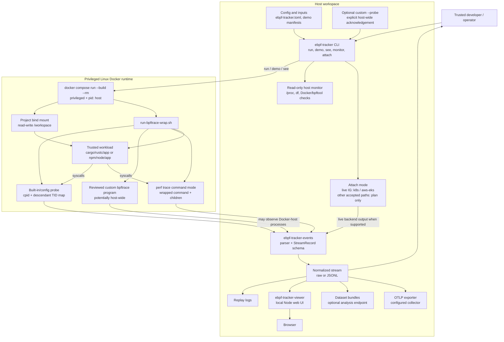

# Architecture

`ebpf-tracker` is an experimental, local-development pipeline. Its primary
boundary is a trusted command running in a high-privilege Linux Docker runtime;
it is not a sandbox or a production fleet agent.

## Trust Boundaries

- The Rust and Node Compose services set `privileged: true`, use `pid: host`,
  and mount the chosen project read-write at `/workspace`. Compromise of the
  wrapped command or tracing container can affect the project and Docker host.
- Built-in `execve.bt` and config-generated bpftrace programs use bpftrace
  `cpid` plus fork/exit tracking to keep event output on the wrapped process
  tree. This is collection filtering, not a privilege reduction.
- An arbitrary custom `--probe` cannot be rewritten safely. The CLI fails
  closed unless the operator explicitly acknowledges potential host-wide
  observation with `--allow-host-wide-probe`. The wrapper has the equivalent
  `EBPF_TRACKER_ALLOW_HOST_WIDE_PROBE=1` environment acknowledgement for direct
  container use. Neither setting adds containment.
- `perf trace` command mode follows the wrapped command and children; it is an
  alternate transport, not a new sandbox.
- The terminal monitor does not enter the privileged tracing runtime. It makes
  bounded, read-only host observations.
- Live `k8s`/`aws-eks` Inspektor Gadget attach uses the caller's local AWS and
  Kubernetes credentials. Scaffold attach paths only print plans.

## Event And Consumer Contract

`ebpf-tracker-events` owns the normalized contract consumed by the viewer,
dataset, and OTel crates. Raw `openat` lines become `EventKind::OpenAt`, which
Serde encodes in JSON as `open_at`; aggregate metric names remain `openat`.

The downstream consumers add views rather than new collection guarantees:

- replay logs persist the normalized stream;
- the viewer exposes a local browser UI;
- dataset analysis may send derived trace context to a configured endpoint;
  and
- the OTel exporter sends spans to a configured collector.

Treat every persisted or exported artifact as potentially sensitive process and
path metadata.

## Compatibility Boundary

The shipped workload runtimes are based on `rust:1-bookworm` and
`node:22-bookworm`. The command runs inside those images, not directly in the
host development environment. Native dependencies and host tools that are not
in the images are unavailable unless the runtime is extended. Docker must
expose compatible Linux kernel tracing facilities.
